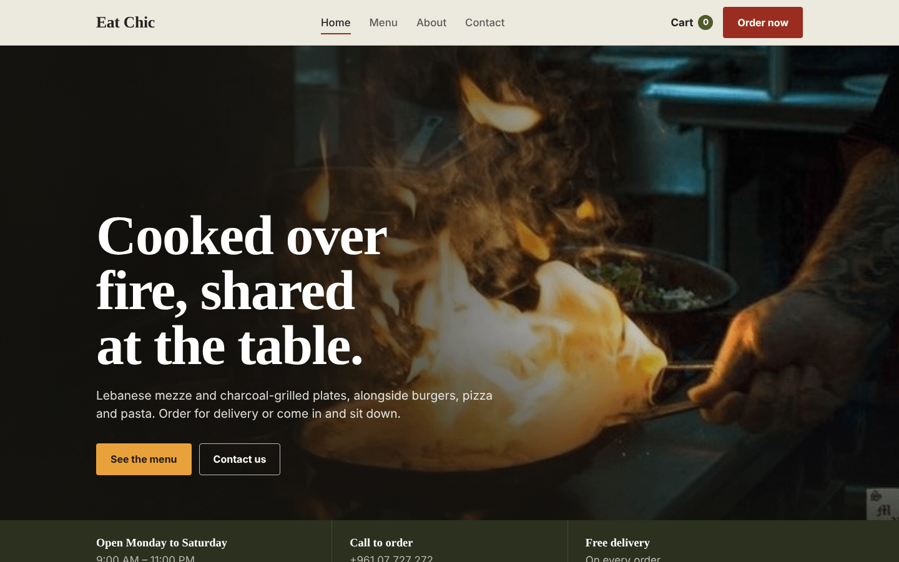
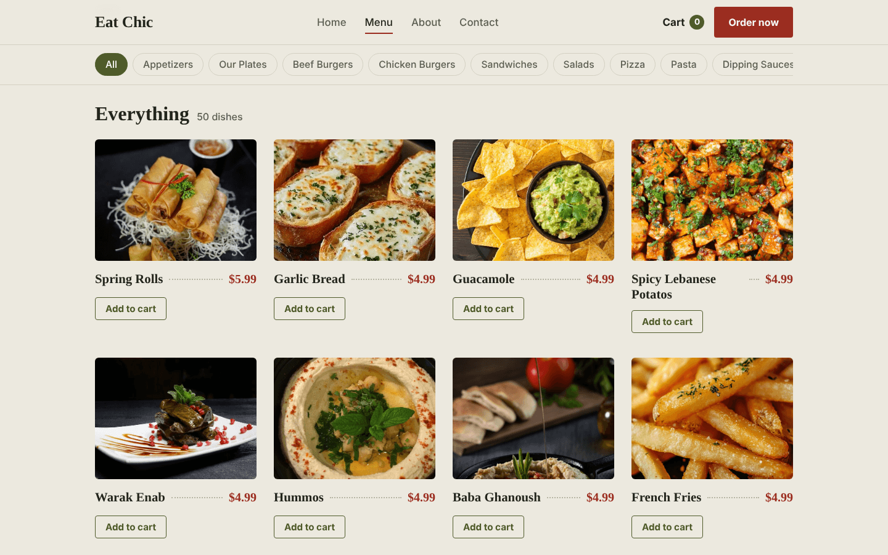
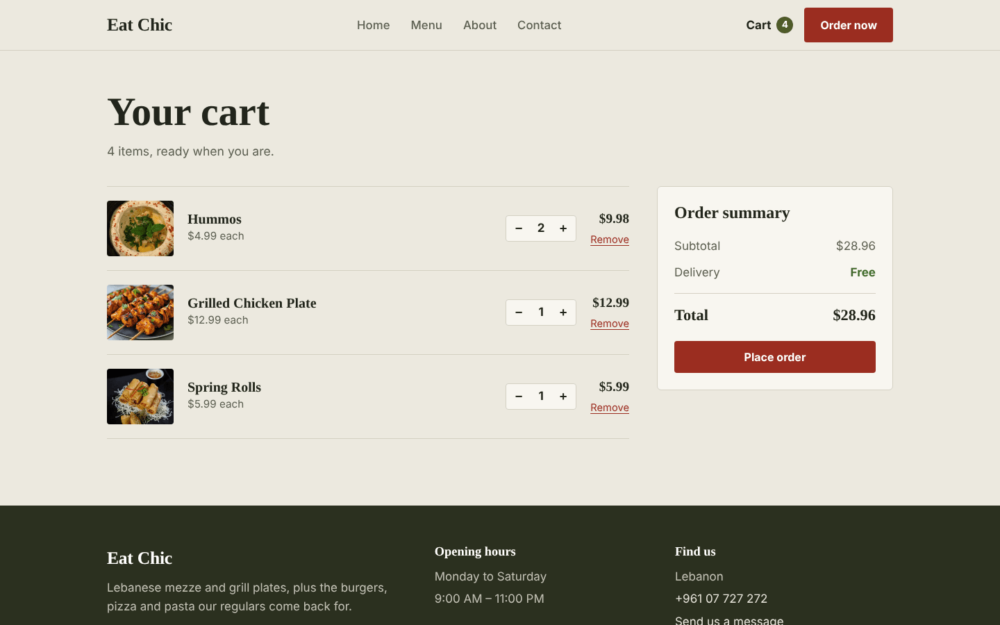
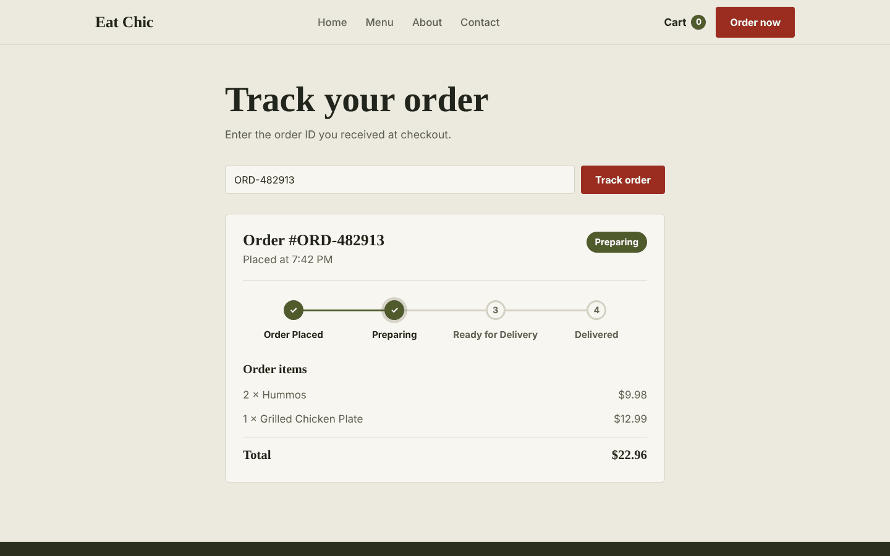
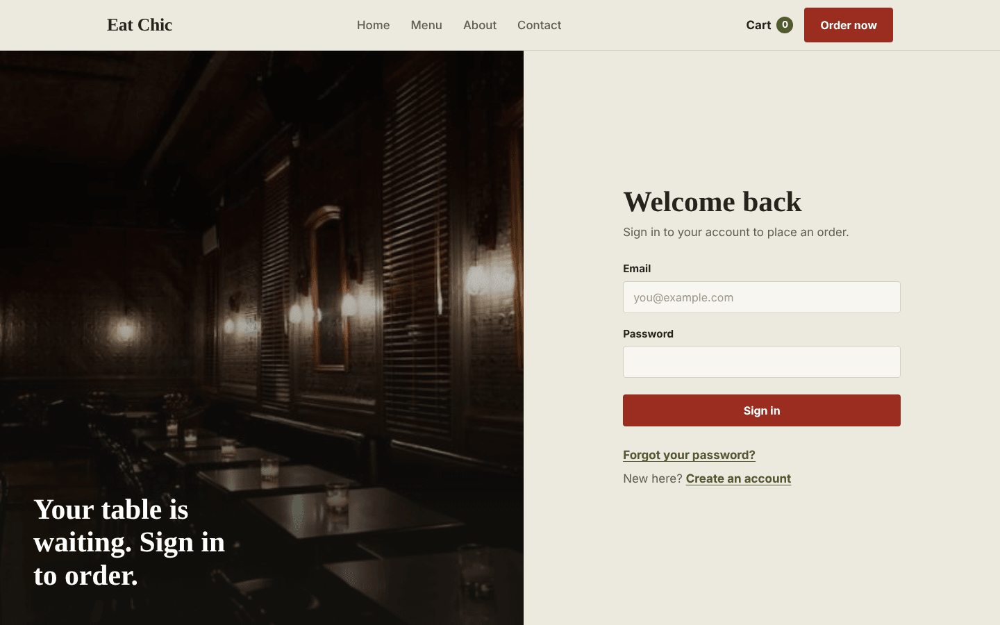
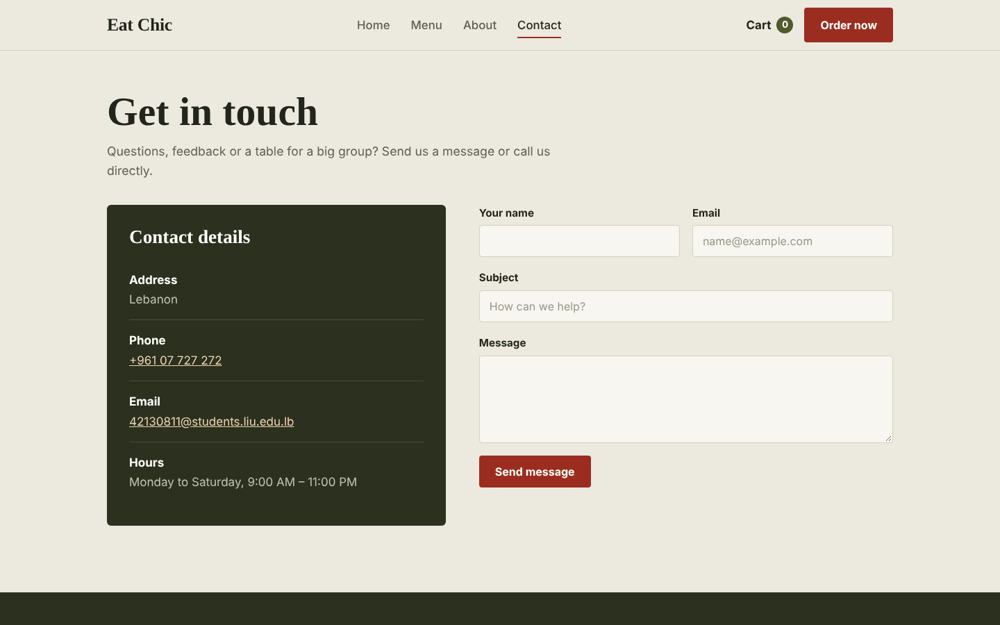
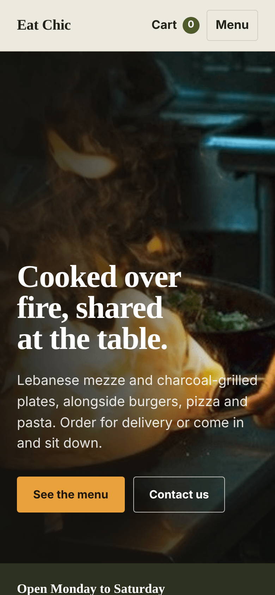
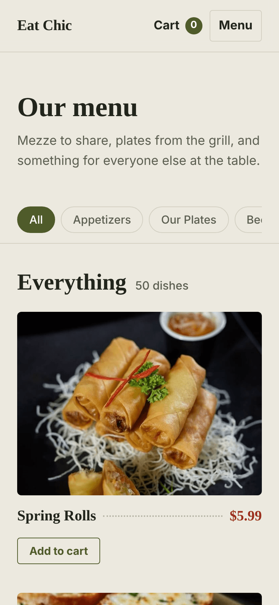

# Eat Chic

A full-stack restaurant ordering website. Customers can browse a 50-dish menu of Lebanese mezze, grill plates, burgers, pizza and pasta, add dishes to a cart, place an order and track it through the kitchen. The site also has user accounts and a contact form that sends a confirmation email.



## Features

- **Menu with categories:** 50 dishes in 10 categories (appetizers, plates, burgers, sandwiches, salads, pizza, pasta, sauces, drinks), loaded from the database, with a filter bar that stays on screen while you scroll.
- **Cart:** add dishes, change quantities, remove items and see a live total. The item count shows in the navigation bar.
- **Checkout and order tracking:** placing an order saves it to MySQL and returns an order ID. The tracking page shows its progress from *Order Placed* to *Preparing*, *Ready for Delivery* and *Delivered*.
- **Accounts:** sign up, sign in and reset your password. Passwords are hashed with bcrypt and sessions use JWT.
- **Contact form:** messages go through the backend, and the sender receives a confirmation email via Nodemailer.
- **Responsive design:** works on phones, tablets and desktops.

## Screenshots

| Menu | Cart |
| --- | --- |
|  |  |

| Order tracking | Sign in |
| --- | --- |
|  |  |

| Contact |
| --- |
|  |

**On mobile**

<p>
  
  &nbsp;&nbsp;
  
</p>

## Tech stack

| Part | Built with |
| --- | --- |
| Frontend | React 19, React Router 7, CSS (custom design system in `src/index.css`) |
| Backend | Node.js, Express 5 |
| Database | MySQL with Sequelize |
| Auth | bcrypt and JSON Web Tokens |
| Email | Nodemailer (Gmail) |

## Project structure

```
resturantWebsite/
├── backend/
│   ├── models/        # MenuItem, Order, User (Sequelize)
│   ├── routes/        # auth, menu, orders, contact
│   ├── utils/         # sendEmail.js
│   ├── db.js          # MySQL connection
│   ├── seed.js        # fills the database with the menu
│   └── server.js      # Express app (port 5000)
├── frontend/
│   ├── public/
│   └── src/
│       ├── Components/  # NavBar, Footer, CartContext, OrderTracker
│       ├── pages/       # Home, Menu, About, Cart, Contact, Login
│       ├── images/      # dish photos
│       └── index.css    # colors, fonts and all page styles
└── docs/screenshots/
```

## Running it locally

You need **Node.js 18 or newer** and **MySQL**.

### 1. Set up the database

Create an empty database in MySQL:

```sql
CREATE DATABASE restaurant_db;
```

### 2. Start the backend

```bash
cd backend
npm install
```

Copy `.env.example` to `.env` and fill in your own values:

```
PORT=5000
DB_NAME=restaurant_db
DB_USER=root
DB_PASSWORD=your_mysql_password
DB_HOST=127.0.0.1
EMAIL_USER=your_gmail_address@gmail.com
EMAIL_PASS=your_gmail_app_password
JWT_SECRET=any_long_random_string
```

`JWT_SECRET` signs login tokens, so pick a long random value. `EMAIL_PASS` must be a Gmail [app password](https://support.google.com/accounts/answer/185833), not your normal Gmail password.

Load the menu into the database, then start the server:

```bash
node seed.js
npm start
```

The API runs at `http://localhost:5000`.

### 3. Start the frontend

In a second terminal:

```bash
cd frontend
npm install
npm start
```

The site opens at `http://localhost:3000`.

## API

| Method | Endpoint | What it does |
| --- | --- | --- |
| `GET` | `/api/menu` | List all menu items |
| `POST` | `/api/orders` | Place an order, returns the order ID |
| `GET` | `/api/orders/:orderId` | Get an order and its status |
| `POST` | `/api/auth/signup` | Create an account |
| `POST` | `/api/auth/login` | Sign in, returns a token |
| `POST` | `/api/auth/reset-password` | Set a new password |
| `POST` | `/api/contact/send-message` | Send a contact message and confirmation email |

## Author

Maryam Fakih
